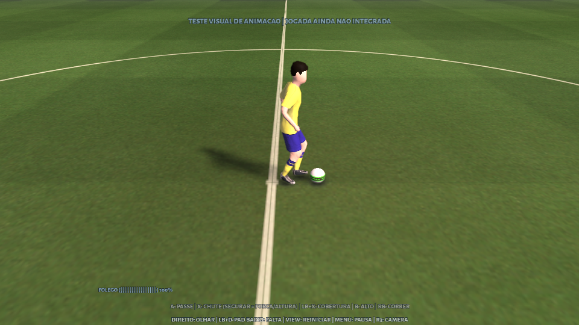

# Animações do PES 2017 recebidas

O `dt13_win.cpk` enviado contém o acervo corporal necessário para começar:
10 arquivos MTAR, `body_anim_skel.ask` e `body_skel.frig`. Foram extraídos e
lidos **2.956 clipes**, com **2.365 nomes** identificados pelo hash Fox e pelo
mesmo ID presente no mapa de nomes do PES 2021. Os outros 591 conservam hash
e ID, sem inventar nomes. O catálogo é apenas metadados:
[pes2017-motion-catalog.json](pes2017-motion-catalog.json).

O CPK tem 24.039.984 bytes e SHA256
`25d2dad1dd2d41b42c98e075daf3fa6fde1c159c63af9f7f40014b383e3d9342`.
Dois leitores conferiram o índice; o leitor próprio validou os intervalos de
295 entradas antes de exportar qualquer recurso. Os 28 recursos de metadados
selecionados concordam byte a byte entre os leitores. Os dados originais e as
poses decodificadas ficam fora do repositório e do ZIP público.

## Diferenças encontradas no formato

As pernas usam unidades FRIG de tipo 3 com 80 bytes. Elas contêm canais de
alvo IK, seguidos dos canais FK da coxa e da canela. O leitor genérico associava
a primeira rotação ao primeiro osso, colocando a rotação de alvo na coxa.
A extensão em `read_pes_gani.py` respeita os índices explícitos e preserva os
alvos separadamente. Dois clipes de preparação de saída de bola usam esses
alvos: `kickoff_loop_kicker` e `kickoff_loop_waist`. A adaptação direta desses
dois clipes é bloqueada até haver uma reconstrução dos alvos.

Também foi corrigida uma leitura de tempo: a translação do clipe
`gkblockcover_crash_f03_3_0_y02` contém intervalos de 194 e 191 quadros.
Ler os bytes como inteiros com sinal descartava as últimas chaves. Com a
leitura sem sinal, ambas terminam corretamente no quadro 258. A correção é
coberta por um arquivo sintético independente.

Os nomes e IDs compartilhados não justificam copiar durações e marcadores de
2021: somente 1.697 dos 2.365 clipes nomeados têm a mesma contagem de quadros
naquele mapa. A escala angular `pi/2` e a cadência de 30 FPS continuam sendo
as hipóteses do leitor upstream, ainda sem comparação com o PES executando.
Valores finitos e uma pose plausível não comprovam equivalência à engine.

## Primeira adaptação no modelo do Football

O movimento `run_2_0` foi adaptado de 20 para 13 ossos, com base na anatomia,
nos vetores dos segmentos e no bind real do modelo. A conversão de eixos é
uma rotação própria `(X,Y,Z) -> (X,-Z,Y)`: não troca os lados do corpo.
A raiz horizontal fica fora do clipe nativo para evitar deslocamento duplo.
O protótipo atual resolve apoio em pé; poses de queda exigem outro contato
com o chão e são recusadas pelo conversor.

A amostragem gerou 91 poses a 100 Hz. Nos quadros 0, 45 e 90, o executável
renderizou a malha original, preservando os ossos e as distâncias rígidas,
sem valores inválidos e com as chuteiras acima do gramado. São três poses
verificadas, não uma validação de todas as transições ou de todo o acervo.



Esta é uma **prévia visual**, ativada explicitamente por configuração. Ela
não registra candidatos de gameplay, não decide recepções/chutes e não cria
contatos com a bola. Sem a opção de prévia, o treino usa a gameplay aprovada;
o teste de câmera e movimentos nativos passou novamente. O pacote Windows
público continua sendo a versão anterior, sem esses clipes instalados.

## Reproduzir com os arquivos locais

Depois da extração validada do CPK, decodificar um dos MTARs para uma pasta
nova, conservando o rig e os alvos:

```bash
python3 tools/animations/read_pes_gani.py body_anime_file7.mtar \
  --skeleton body_anim_skel.ask --rig body_skel.frig --output /tmp/pes17-decoded
```

Encontrar o JSON cujo campo `name` é `run_2_0`; os nomes de saída usam hash e
ordinal, para não sobrescrever arquivos. Converter apenas esse JSON:

```bash
blender -b --python tools/animations/retarget_fox_clip.py -- \
  /tmp/pes17-decoded/00131-72244c1c.json \
  /tmp/pes17-decoded/source-rig.json /tmp/run_2_0.anim
```

Em uma configuração de treino solo separada, acrescentar um caminho absoluto
para o clipe convertido e, opcionalmente, um quadro fixo:

```text
"training_pose_preview_file" "/tmp/run_2_0.anim"
"training_pose_preview_frame" "45"
```

Sem quadro fixo, a prévia toca uma vez e mantém a última pose; não se apresenta
esse movimento como um loop fechado. O teste gráfico usa:

```bash
python3 tests/training_pose_preview_smoke.py --build build \
  --clip /tmp/run_2_0.anim --output /tmp/pes17-review
```

O próximo trabalho é conferir movimentos prioritários contra a execução
original, verificar a cadência, anotar o contato correto e adaptar a preparação
e a saída de cada jogada ao seletor do Football. Os arquivos recebidos bastam
para continuar essa análise; a biblioteca completa ainda não está ligada à
partida. Resultados e limites estão em
[pes2017-animation-import-validation.json](pes2017-animation-import-validation.json).
