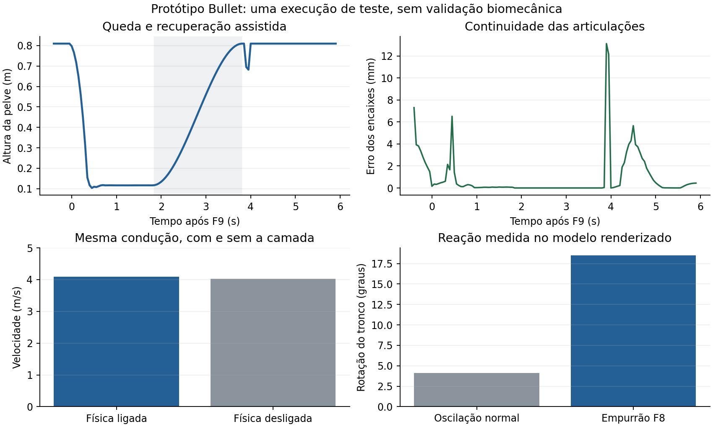

# Treino físico: revisão com Bullet e busca de movimento

Extraia o **pacote Windows completo em uma pasta nova** e abra
**treino-fisico.bat**. R3/Tab mostra o corpo. F7 compara a camada ligada e
desligada, F8 aplica um empurrão recuperável, F9 provoca uma queda lateral e
R/View reinicia. `partida-fisica.bat` permite testar contatos com a CPU.
`run-training.bat` e `jogar-partida.bat` mantêm o perfil aprovado.
A sensibilidade da câmera aumentou de 2,6 para 3,8, nos dois perfis.

## O problema da primeira versão

Os testes anteriores confirmavam que o esqueleto era finito e não esticava,
mas não demonstravam uma queda natural ou uma transição visual boa. O usuário
identificou corretamente os mortais, a reação pequena do F8 e a rigidez.

A queda anterior usava uma raiz generalizada e projeções aproximadas do chão.
O F9 aplicava 230 N·s a 55 cm: um momento de impulso de 126,5 N·m·s. A raiz
recebia rotação excessiva, e as correções de penetração podiam acrescentar mais
rotação. Na locomoção, a camada reaplicava poses absolutas sobre o resultado
suavizado do motor. As correções de alcance também desapareciam quando o
marcador mudava, em vez de cada pé voltar gradualmente ao movimento original.

Esses problemas motivaram a substituição do solucionador de queda e novos
critérios de avaliação. Não basta um teste dizer que os números são finitos.

## Motor físico incorporado

O projeto agora compila estaticamente o núcleo CPU do **Bullet Physics 3.25**,
revisão `2c204c49e56ed15ec5fcfa71d199ab6d6570b3f5`:
[projeto original](https://github.com/bulletphysics/bullet3/tree/2c204c49e56ed15ec5fcfa71d199ab6d6570b3f5),
[licença zlib](../third_party/bullet/LICENSE.txt) e
[registro de origem](../third_party/bullet/UPSTREAM.json).
O código upstream foi mantido sem alterações. A licença acompanha os ZIPs;
não é preciso instalar Bullet nem baixar uma DLL adicional.

Há 13 corpos com massas, inércias calculadas a partir das formas, cápsulas,
contato com o chão, atrito, amortecimento e articulações de seis graus de
liberdade com translação bloqueada e limites angulares. Joelhos e cotovelos
possuem limites diferentes dos ombros e quadris. Articulações vizinhas e
sobreposições de encaixe não colidem entre si; outras partes podem colidir.
Os comprimentos do modelo visual continuam fixos.

Na locomoção, a raiz e as pernas seguem a animação aprovada. Tronco, cabeça e
braços são corpos dinâmicos acompanhando referências por motores de torque.
A saída é misturada de maneira limitada à postura de referência, preservando
as transições do jogo. A cabeça renderizada continua seguindo a câmera.
Durante um passe, chute ou domínio, a pose de contato tem prioridade sobre
as pequenas respostas físicas para não deslocar o peito ou a cabeça da bola.

Na queda, todos os segmentos se tornam dinâmicos. O impulso inicial é
convertido em momento linear e angular usando a massa e a inércia da montagem
inteira, não uma rotação arbitrária da pelve. O F9 foi recalibrado para
165 N·s a 18 cm: 29,7 N·m·s, em vez de 126,5. Limites dissipativos de velocidade
angular evitam chicotadas numéricas de segmentos leves. Esses limites são
ajustes do protótipo, não medidas clínicas de um atleta.

O F8 combina a resposta física do tronco com uma postura amortecida de
recuperação do equilíbrio. A aproximação de um adversário acrescenta uma
referência de proteção ao braço do lado correspondente. Esse alvo vem do
adversário, não da bola. O contato entre jogadores continua sendo detectado
pelo motor original e envia impulsos ao ator físico controlado.

Após a queda, uma recuperação assistida mistura a pose caída com a postura
nativa por dois segundos. Ainda não existe uma política muscular aprendida
que se levante autonomamente. A bola conserva a física nativa; a colisão
passiva com a malha agora também aceita bolas rasteiras junto ao corpo caído.

## Busca de animação por características

A camada implementa uma **busca de movimento com entradas restritas**.
Cada candidato contém posições e velocidades dos dois pés, cabeça e dois
antebraços, além de posição e direção futuras da raiz em três horizontes:
150, 300 e 450 ms. A consulta combina a pose atual com a trajetória solicitada
pelo controle. Quando o comando não solicita movimento ou uma nova direção
do olhar, a consulta conserva a velocidade ou a frente atual. Um custo ponderado compara pose, continuidade de velocidade,
trajetória e orientação em unidades físicas explícitas.

O seletor nativo primeiro determina quais animações são elegíveis. A busca
reordena esses candidatos e o cálculo nativo de alcance, direção e instante
de contato continua tendo a palavra final. A ação explícita do jogador tem prioridade:
um domínio antecipado no peito não toma a bola de uma cabeçada ou passe de
primeira já solicitado. Cabeçadas paradas continuam elegíveis durante pequenos
ajustes de recepção abaixo de 1,5 m/s, respeitando alcance, trajetória e
contato na malha. A preferência pelo pé direito
permanece, com alternativas quando uma jogada exige outro apoio.

O projeto de referência consultado foi
[Motion-Matching, de Daniel Holden](https://github.com/orangeduck/Motion-Matching/tree/57b7250e0d34a4e456a34d47e24c2f05fdcc711e).
Foram estudados `database.h`, `controller.cpp`, `character.h` e `spring.h`,
incluindo características de pose/velocidade/trajetória e transições.
A implementação aqui é própria; não usa as redes treinadas, Raylib nem o
banco de animações externo daquele projeto.

**O limite atual é importante:** os candidatos entram no início autorizado
da animação. A busca não salta livremente para qualquer frame de qualquer
clip. Isso preserva os marcadores de passe, chute e domínio do Football.
Portanto, não se trata de um controlador irrestrito de motion matching com
uma biblioteca grande de captura de movimento.

O banco nativo continua com 293 arquivos e os domínios adicionais aprovados.
Os parâmetros contínuos de pressão, velocidade, giro, alcance e reação física
produzem variações sem duplicar arquivos. Os 270 contextos de teste não são
270 novas capturas de movimento. Aumentar a variedade não recupera movimentos
que nunca existiram nos dados, como uma cabeçada específica de outro atleta.

## Fluidez e contato visível

A camada ativa aplica diferenças de rotação sobre a pose já suavizada pelo
jogo. Ela não substitui a condução inteira por amostras absolutas. Cada pé
tem um envelope independente de alcance e retorno, limitado a 28 cm/s e
8 cm. As pernas não alternam uma correção residual de um pé para o outro.
O tronco tem um limite menor de alcance.

Nos instantes de jogadas, uma janela suave aproxima a pose mostrada da pose
utilizada pelo cálculo de contato. Fora dessa janela, as transições originais
continuam disponíveis. O impulso da bola ainda exige contato na malha
ponderada; a tolerância de 2,5 mm não foi ampliada para fazer o teste passar.

O relógio de animação continua independente da integração física. Mais de
uma amostragem de pose no mesmo passo não integra a dinâmica novamente.
O Bullet usa dois subpassos por passo de 10 ms; os motores limitam torque,
aceleração e correções de postura. A câmera mantém o horizonte estável.

## Pesquisa e observações de movimento

O registro da revisão está em
[physical-rig-v2-research.json](physical-rig-v2-research.json). A pesquisa
anterior, inclusive os PDFs de XPBD e DeepMimic e os acessos bloqueados,
permanece em [physical-rig-research-sources.json](physical-rig-research-sources.json).

| Referência acessada | Uso e limites |
| --- | --- |
| Bullet 3.25: código de corpos rígidos, constraints, springs e exemplos de constraints | Motor incorporado; articulações, inércias, atrito, colisão e amortecimento reais. Os limites do nosso modelo foram adaptados aos 13 ossos nativos. |
| Motion-Matching: código completo dos módulos de busca e do controlador | Fundamenta a separação entre características de pose, velocidade e trajetória. O banco e as redes externas não foram importados. |
| DeepMimic, artigo e implementação de controle PD | Referência para acompanhar animações com torque e distinguir animação cinemática de controle físico aprendido. Nenhuma política de aprendizado por reforço foi treinada aqui. |
| SoccerKicks: código, licença e demonstração `overview/gif_over.gif` | Foram analisados 57 quadros em 2,85 s, com vídeo real, estimativas 2D e reconstrução 3D do mesmo chute. As colunas não são jogadas diferentes nem múltiplas câmeras calibradas. |
| FilteredSoccerPose: sequência `12_penalty` e sobreposição de poses | 121 quadros em aproximadamente 3,63 s, consultados na etapa anterior e revistos como referência visual. |
| OpenSim Gait10dof18musc | Referência de estrutura de modelo biomecânico, massas e articulações. Não fornece uma validação científica específica do nosso personagem. |
| Jolt Physics: documentação do projeto | Alternativa aberta avaliada; não foi incorporada nem comparada em benchmark neste projeto. |

Nas sequências reais observadas, o pé de apoio se estabelece antes da extensão
final da perna que chuta. A perna que acompanha o chute continua o movimento;
ela não alcança a bola e volta instantaneamente. Os braços abrem de forma
assimétrica, o tronco contrarrota e o atleta reorganiza os apoios depois da
finalização. As estimativas 2D/3D exibidas também oscilam e podem errar a
profundidade dos pés: copiá-las diretamente produziria novos tremores.
Essas observações orientaram a preservação de fase, a continuidade de
velocidade e o retorno gradual dos alcances.

Não foi analisada uma biblioteca completa de partidas, cabeçadas, domínios e
disputas, nem realizada rotoscopia calibrada desses movimentos. Não há base
para prometer uma cópia exata de todos eles a partir de vídeos monoculares.
O retargeting de movimentos FBX já existente continua disponível, mas a
conversão automática de uma partida em novas animações 3D permanece fora
do que foi implementado nesta revisão.

## Cálculos e verificação

Os motores usam o erro angular de quaternion e a velocidade angular para
obter uma aceleração desejada: `α = Kp·log(q_alvo·q_atual⁻¹) − Kd·ω`.
A inércia mundial converte essa aceleração em torque, com limites explícitos.
O Bullet resolve as reações de contato e de articulação. A energia é medida
somente nos corpos dinâmicos; corpos cinemáticos não são invertidos como se
tivessem uma inércia finita.

Os testes verificam massas/poses finitas, comprimento dos ossos, erro dos
encaixes, rotação acumulada na queda do F9, velocidades de segmento, recuperação,
retorno gradual do alcance, busca por características e 270 contextos.
As verificações gráficas incluem comparação de velocidade com F7, reação
**do tronco renderizado** ao F8, sequência da queda, câmera mais rápida,
chutes em corrida, domínios, cabeçadas e preservação dos modos aprovados.

Nesta revisão passaram **104 verificações renderizadas**, 25 verificações do
núcleo e cinco testes CTest. O pacote passou por 110 conferências de
executável, dependências, recursos, atalhos, licenças e integridade.

Imagens do teste: [condução](images/physical-v2-dribble.png),
[F8](images/physical-v2-f8.png), [queda aos 450 ms](images/physical-v2-fall-450.png),
[queda aos 1.100 ms](images/physical-v2-fall-1100.png) e
[recuperação](images/physical-v2-recovered.png).

Os resultados, imagens e restrições estão em
[physical-rig-v2-validation.json](physical-rig-v2-validation.json).
Os testes gráficos são Linux com SDL/Xbox virtual. O pacote Windows é
compilado e conferido; Windows 11 e o controle físico precisam do teste no PC.

## O que continua limitado

A locomoção não é uma simulação muscular completa: pernas e raiz seguem as
animações, e a camada superior mistura resposta dinâmica limitada. A recuperação
é assistida. Na partida, os demais jogadores conservam o corpo e a IA nativos;
não há 22 ragdolls articulados simultâneos. O mundo Bullet deste experimento
não converte automaticamente toda a geometria do estádio em colisores.
As massas segmentares e os limites são aproximações de desenvolvimento.

Há ainda uma falha intermitente de domínio `Chest_Run` documentada na revisão
anterior. Esta revisão testa o domínio parado e as regressões de ações, mas
não declara essa falha anterior resolvida. Fluidez e naturalidade devem ser
avaliadas em jogo, inclusive em mais combinações do que as sequências finitas
dos testes automatizados.
