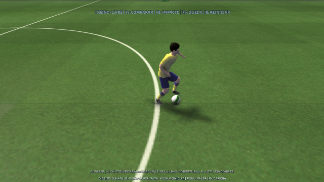
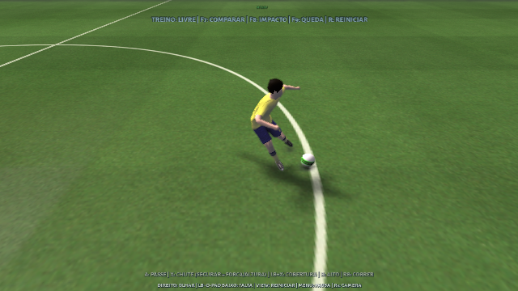

# Mira nas recepções e participação do corpo

Extraia o pacote completo em **uma pasta nova** e abra **treino-fisico.bat**.
R3/Tab alterna a câmera. F1 permite comparar a adaptação de tronco e braços;
F7 compara a camada física. `run-training.bat` conserva o treino aprovado,
com a mesma correção de mira, e sem a camada corporal experimental.

RT fica reservado no treino. A passagem do pé e o arrasto de sola foram
removidos, incluindo o caminho que interrompia a seleção normal de movimentos.
Na partida, RT sem bola conserva o pedido de passe ao companheiro.

F4 lança um passe rasteiro; F5 envia ao peito; F6 envia uma bola alta.
Antes da chegada da bola, mire com o analógico esquerdo e prepare A para
passar, Y para passe em profundidade, B para cruzar ou X para finalizar.
Apertos repetidos conservam a ação pendente. Ao centrar o analógico, a
recepção conserva a última mira escolhida até o contato. O movimento dos pés
continua assistido, com avanço/recuo, sem eliminar a componente lateral da mira.
A animação e a dificuldade ainda limitam correções tardias de direção.

O problema vinha do uso da direção de deslocamento, projetada no eixo de
recepção, como direção de passe/chute. Essa projeção não pode definir o alvo.
Também foi corrigido o uso da direção refinada pelo solver de chutes aéreos.

A adaptação corporal mantém carga durante o contato e continua na finalização,
em vez de zerar o tronco nesse instante. Nove famílias mudam os eixos e a
sequência de esforço: compacta, lateral, contrapeso aéreo, chute baixo forte,
passe por dentro, lançamento alto, giro amplo, primeira e proteção sob pressão.
Altura da bola, direção, esforço, corrida e adversário escolhem a resposta.
Os filtros limitam velocidade e aceleração; os limites dos braços continuam
ativos após a mistura gráfica. Raiz, pernas e marcadores de contato permanecem
sob a seleção nativa. Cabeceios preservam a cadeia de contato até atingir a
bola e podem recuperar o tronco depois. Defesas e domínios de peito conservam
seus movimentos próprios.

O catálogo contém **2.998 perfis procedurais** (2.997 ativos e um neutro).
São parâmetros aplicados às animações existentes, com interpolação contínua,
e **não 2.998 animações capturadas ou reconstruídas de vídeos**. Os 10.398
pares de fonte/perfil, incluindo espelhamentos, são candidatos auditados por
metadados, não milhares de jogadas validadas individualmente no jogo.

A validação gráfica usa Linux/X11 e um Xbox virtual. O executável Windows é
compilado para x64 e o ZIP é verificado com DLLs e recursos; o teste com
Windows e controle físico depende do computador do jogador.

Foram aprovadas **430 verificações gráficas em 20 suítes**, 91 verificações
dos solucionadores, 14 testes do catálogo, sete testes CTest e 73 verificações
dos pacotes. As 3.240 combinações numéricas verificam limites e preservação
dos apoios; não representam 3.240 partidas ou capturas novas.
A mira foi medida pela velocidade real de saída e pelo percurso posterior
da bola, incluindo diagonais e laterais, apertos repetidos e retorno do
analógico ao centro, nas duas câmeras e no treino aprovado sem física.

O [relatório verificável](aim-body-validation.json) registra hashes dos
executáveis, resultados, medições e limites. Preserva as falhas intermediárias:
a classificação de cabeçadas pelo braço, um timeout do teclado virtual e
uma amostragem gráfica que perdeu o instante do chute durante uma captura.
Os cenários afetados foram repetidos com o mesmo executável final. A medição
da simulação permanece a até 30 ms do toque; a pose gráfica é verificada na
preparação/finalização a até 250 ms, pois a renderização tem frequência própria.
A tolerância de contato real permanece em 2,5 mm, sem afrouxar os limites de
anatomia, alcance ou penetração.
