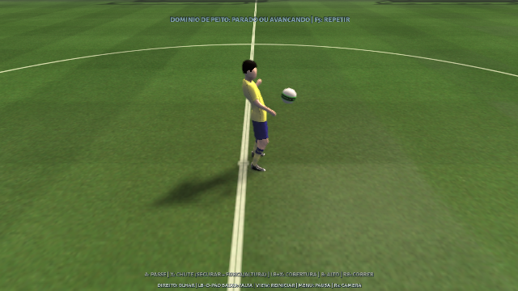
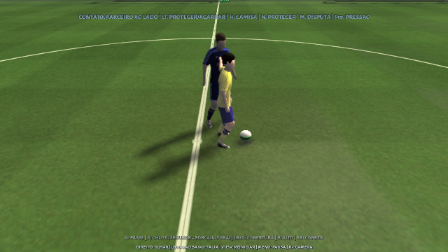
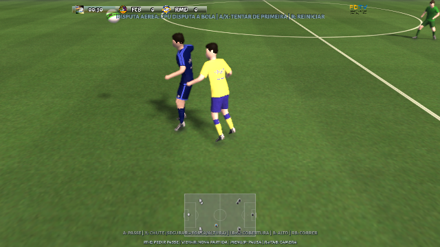

# Busca de poses e interação corporal

A revisão seguinte acrescenta ciclos FBX e corrige fluidez/cobranças;
consulte [MOVIMENTO-E-COBRANCAS.md](MOVIMENTO-E-COBRANCAS.md) para o estado atual.

Extraia o ZIP completo em uma pasta nova e abra `treino-fisico.bat`.
Use R3/Tab para observar o corpo. F12 compara a busca de quadros e as
transições desta revisão; F7 compara a camada física inteira.
F4 envia um passe rasteiro, F5 uma bola ao peito e F6 uma bola alta.
F10 alterna parceiro ao lado, parceiro pressionando e treino individual.
Com a bola, LT/L2 ou N protege; sem ela, LT/L2 ou H tenta segurar a camisa.
Na `partida-fisica.bat`, Alt+F2 prepara uma disputa aérea lado a lado.
O exercício posiciona jogadores e lança a bola; o resultado depende da
seleção e do contato reais. A/X antes da chegada prepara uma ação de primeira.

## Implementação

A revisão anterior comparava principalmente a entrada de cada animação.
Agora o banco armazena quadros a cada 20 ms com 50 características: posições
e velocidades de pés, cabeça e cotovelos, três posições e orientações futuras,
e apoio de cada pé. A busca exata usa limites por blocos para descartar
candidatos que não podem vencer. Todos os jogadores compartilham o índice.
A seleção nativa continua filtrando ações possíveis. Entradas no interior
de um ciclo são permitidas apenas na locomoção estável sem contato;
viradas, partidas, paradas, passes, chutes, cabeceios e domínios preservam sua
preparação original. O salto de fase altera a pose, mantendo o relógio da
trajetória física para evitar paradas e saltos no deslocamento.

As trocas de clipe preservam a pose e a velocidade angular de saída por
inertialização rotacional com amortecimento crítico. Juntas de contato
retornam à pose autoral antes do toque. O renderizador não aplica uma
segunda suavização sobre essa mistura. A câmera conserva o controle da cabeça.

Na proteção, o quadril abaixa e se afasta da pressão, com IK mantendo os
apoios dos pés. A antecipação da recepção prepara tronco e braços usando a
mesma previsão de trajetória da bola real, incluindo quique. O domínio
continua exigindo contato com a malha deformada, sem aumentar a tolerância.
Essa preparação cede a ações já iniciadas e a uma mão apoiada no adversário;
ela não acumula uma pose escondida para reaparecer abruptamente após a ação.
Um passe alcançável pode solicitar uma animação nativa de domínio antes da
condução de fallback. Comandos explícitos de passe/chute mantêm prioridade.
Na corrida, um filtro preliminar que descartava chutes próximos enquanto
a bola se afastava foi corrigido; a viabilidade final continua geométrica.

Motores dos braços e tronco seguem posição e velocidade angular de referência,
em vez de amortecer todo movimento em direção à velocidade zero. Sobreposição
de volumes do tronco/braços de jogadores próximos transmite pressão e atrito
limitados, com forças opostas. A CPU escolhe disputa aérea sob pressão longe
da área, deixando o seletor nativo encontrar uma cabeçada possível. Tentativas
de agarrar durante o jogo dependem de perseguir o portador em alcance, além
do ensaio explícito; o antigo sorteio periódico foi retirado.
O lançamento de posse do parceiro também atualiza o último toque e a previsão,
evitando tratar uma bola já controlada como um passe livre. O teste de pressão
aceita contatos reais de ombros/braços que ocorrem antes da antiga cápsula do
tronco, exigindo penetração medida, força limitada e ausência de queda automática.

## Aprendizado reproduzível

`training_motion_dump` recebe um caminho de saída JSONL na configuração e
exporta os quadros do banco nativo. O treinamento não é necessário para jogar.
Para repetir com NumPy instalado:

```sh
python3 tools/animations/train_motion_metric.py --input native-frames.jsonl \
  --header src/onthepitch/player/humanoid/learned_motion_metric.hpp \
  --report motion-metric-training.json
```

A métrica diagonal positiva aprende continuidade temporal com negativos de
trajetória semelhante. Famílias de clipes e seus espelhamentos ficam na mesma
partição antes da amostragem: 451 famílias de treino, 138 de validação e 141
de teste. São 65.000 triplas de treino, 12.000 de validação e 12.000 de teste.
O teste reservado ordenou o par temporal correto em 92,53% com os pesos
anteriores, 94,95% com normalização e 95,04% com a métrica treinada. O ganho
sobre a normalização é pequeno e não mede realismo percebido nem precisão
da gameplay. O relatório completo está em `motion-metric-training.json`.

## Pesquisa e limites

O repositório solicitado `orangeduck/Motion-Matching` foi baixado e lido na
revisão `57b7250e0d34a4e456a34d47e24c2f05fdcc711e`. Busca bloqueada e
inertialização usam suas técnicas públicas sob MIT, com atribuição no pacote.
Os movimentos LAFAN e redes pré-treinadas da demonstração não foram importados.
Também foram consultados `Ragdoll::DriveToPoseUsingMotors` do Jolt e o
controlador PD/README do DeepMimic. URLs, hashes, licenças e requisições
bloqueadas estão em `motion-matching-research.json`; páginas bloqueadas não
foram tratadas como fontes lidas.

Os três arquivos pequenos do Unity contêm configurações/referências por GUID;
não contêm poses nem código do controlador. `MotionMatching.zip` ultrapassa
o limite de transferência de 32 MiB e não pôde ser inspecionado. Para análise
posterior, envie `Scripts`, configurações e uma pequena amostra de animações
em ZIPs de menos de 32 MiB cada. Nenhum código desse pacote foi decompilado.

Esta é uma integração nativa híbrida: locomoção e contatos autorais, IK,
controle físico do tronco/braços e quedas articuladas com recuperação assistida.
O contato entre atletas usa volumes limitados e realimentação de força; não
é uma simulação de colisão entre todas as malhas. O aprendizado desta revisão
é da métrica de seleção, não uma política neural de equilíbrio ou síntese de
novos movimentos. Não contém Euphoria, nem demonstra equivalência com ela.

## Verificação

[Resultados e hashes da versão](motion-matching-validation.json) registram
os testes gráficos no Linux com controle Xbox virtual, os testes numéricos e
a comparação do executável Windows empacotado com o build recém-compilado.
Não foi executada uma sessão gráfica do Windows nem um controle físico neste ambiente.
Falhas das primeiras tentativas e as correções ficam no mesmo relatório.

Preparação para receber uma bola e proteção durante os ensaios:





Disputa aérea com a CPU; os testes exigem uma ação de cabeça com contato real:


