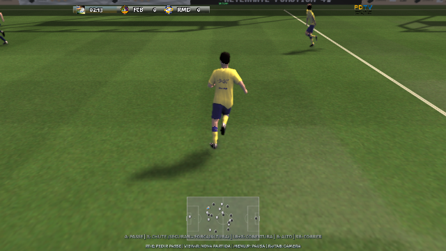

# Movimentação e cobranças

Extraia o ZIP completo em **uma pasta nova**. Abra `treino-fisico.bat` para
os movimentos novos ou `partida-fisica.bat` para testar com os dois times.
RB corre; o analógico direito olha; R3/Tab alterna a câmera. F12 compara a
busca de poses e sua camada de transição. Os lançadores `run-training.bat`
e `jogar-partida.bat` continuam abrindo o modo aprovado sem a camada física.

## Correções

Uma cobrança agora passa por preparação, autorização e contato real do
cobrador. Apertar antes do apito não libera a bola. A animação terminar sem
atingi-la também não encerra a cobrança. A aproximação até a bola continua
permitida após o apito; o jogador do lateral conserva os pés fora da linha.
Os prazos aceitam o primeiro passo de simulação posterior ao horário marcado,
evitando depender de uma igualdade exata do relógio. Escanteios, laterais e
tiros de meta não iniciam uma marcação de impedimento no primeiro toque.
Na partida física, F10 prepara falta, pênalti, escanteio, lateral e tiro de meta.

O corpo exibido interpola a pose física final completa, no mesmo instante
da bola. Antes, a animação e sua correção eram interpoladas separadamente;
a composição podia oscilar nas trocas. A continuação próxima do mesmo
ciclo não reinicia a transição inercial. Um filtro de acompanhamento de
18 ms reduz ruído rápido das juntas; ele não filtra o deslocamento comandado
pelo analógico. As juntas envolvidas no contato abandonam o filtro antes
do toque autoral. Quedas continuam usando a pose física articulada.

## Material recebido

`Locomotion.zip` e `Mocap.zip` foram abertos e catalogados: 37 clipes de
curvas humanoides Unity e 176 intervalos de takes FBX, incluindo espelhamentos
e recortes sobrepostos. Esses números não representam 213 movimentos únicos.
O catálogo registra nomes, intervalos, categorias e hashes em
[uploaded-motion-catalog.json](uploaded-motion-catalog.json).

Dez ciclos FBX foram convertidos para as 13 juntas do modelo nativo:
espera, caminhada, corrida, sprint e seis deslocamentos/diagonais. O banco
recebe também o espelhamento nativo desses clipes. São movimentos de
locomoção sem eventos de bola; não foram rotulados como passes ou domínios.
O modelo conserva suas proporções. As emendas recebem correção distribuída
e o apoio dos sapatos é recalculado depois dessa correção. Metadados de
conversão e hashes estão em [mocap-retarget.json](mocap-retarget.json).

Os 37 `.anim` Unity contêm curvas humanoides, não rotações diretamente
aplicáveis ao nosso esqueleto. Permanecem catalogados para conversão posterior.
A máscara enviada habilita cabeça e braços, mas **exclui o tronco**; não foi
aplicada cegamente ao domínio de peito existente. Arquivos `.meta` de pastas
contêm referências GUID, não animações adicionais.

`Code.zip` contém 169 fontes C# e nenhum clipe. Foram estudados os custos de
pose/trajetória, a continuidade de ciclos, o tratamento de eventos e as
restrições de root motion. O código do pacote permanece privado fora do
repositório público; o executável usa implementação nativa C++.

`Demo.zip`, `FOOTBALL_KINGDOM_BANANAMAN.zip`, `Animations.zip` e `Data.zip`
excederam o limite de transferência de 32 MiB e não foram inspecionados.
Se ainda forem necessários, `dividir-arquivos.bat` permite escolher ZIPs e
cria partes de 30 MiB com manifesto e SHA-256, preservando o original.
Envie o manifesto e todas as partes do mesmo arquivo para remontagem.

## Validação

Os testes exercitam cobranças reais, entrada antes do apito, retomada com
um único humano fixo e apoio do lateral. A fluidez é medida em passos de
simulação fixos, sem confundir variações de FPS com aceleração das juntas;
o renderizador também é comparado com a pose que calcula os contatos.
Quando há várias avaliações no mesmo passo, a medição conserva a última.
O banco convertido é verificado contra as proporções e os volumes dos sapatos.
No ensaio de 3,2 s por cenário, com semente 7 e entrada Xbox virtual, a
aceleração angular RMS das juntas caiu de 580,58 para 347,02 rad/s² na
corrida e de 515,04 para 265,05 rad/s² no strafe. É uma medida de ruído
nesse ensaio, não uma porcentagem geral de realismo. O erro entre a pose
das pernas exibida e a pose interpolada dos contatos foi zero.
Esta revisão não demonstra equivalência com Euphoria nem importa sua engine.

[Relatório da revisão](mocap-restart-validation.json) registra os executáveis,
o pacote Windows e os testes. Os ensaios gráficos usam Linux com controle
Xbox virtual; a sessão gráfica Windows e o controle físico ainda precisam
ser conferidos no computador do usuário.

Partida do ensaio com ciclos convertidos executados pela CPU:

