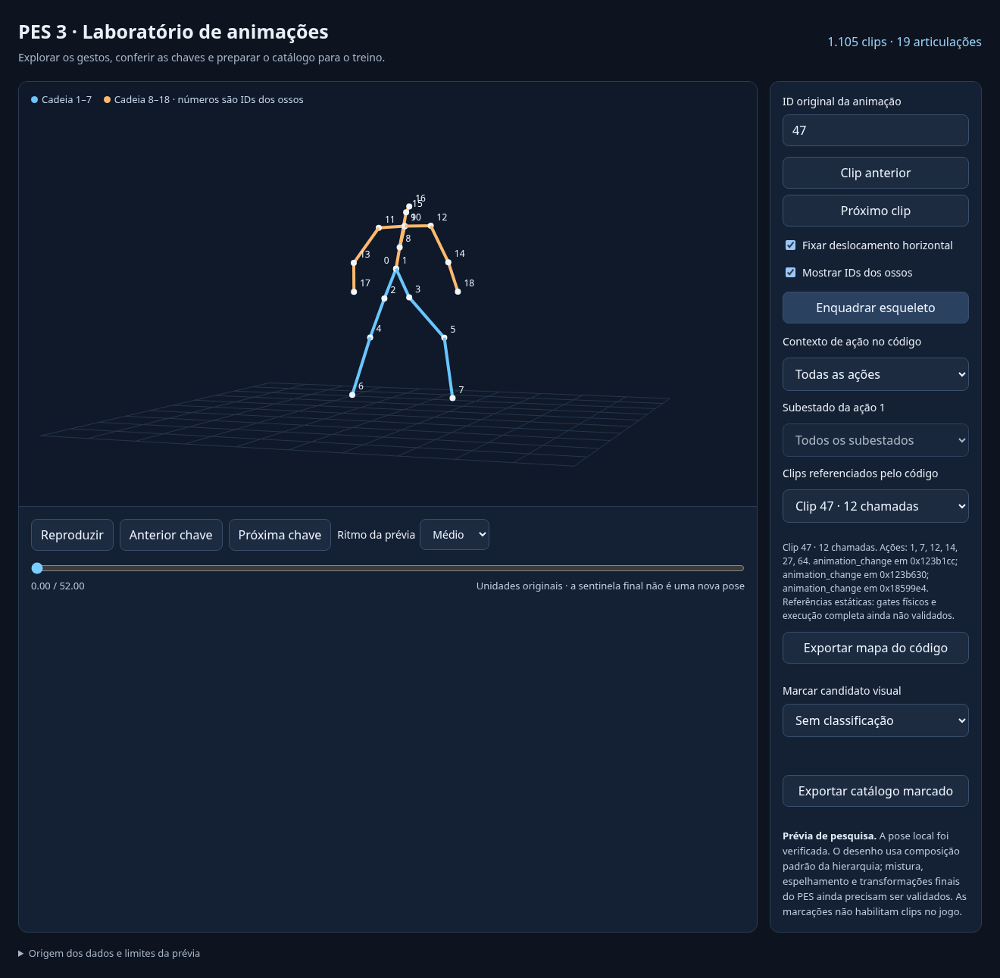

# Recuperação automática de ações e animações do PES 3

O processo agora extrai referências de animação diretamente do código recebido,
sem exigir classificação visual de cada clip. A entrega contém desassemblagem,
grafos de controle, chamadas e uma reescrita executável de três roteamentos.
**A decompilação e a reescrita completas da gameplay ainda não estão prontas.**
Os corpos das ações, as condições físicas e os dados carregados durante uma
jogada precisam de recuperação e validação antes da integração ao treino.

## Usar o resultado no Windows

Baixe [pes3-action-research.zip](../artifacts/pes3-action-research.zip), extraia
e abra `abrir-laboratorio.html` com Edge ou Chrome. O pacote funciona offline
e inclui os 1.105 clips. Escolha um número em “Contexto de ação no código”;
na ação 1, também é possível filtrar pelo subestado. “Exportar mapa do código”
baixa as associações geradas sem marcar animações manualmente.

Os números de ação/subestado preservam o código original. O filtro mostra
**referências estruturais possíveis**: ainda não garante que a posição da bola,
o apoio, a velocidade ou outra condição permita aquele gesto em uma jogada.
Os 599 clips sem referência recuperada continuam acessíveis em “Todas as ações”.
Não se atribuiu um nome de passe/chute/corrida a um ID sem comprovação.



## O que foi recuperado

A leitura usou os bytes de `SLES_519.12` e da entrada 6, `game.ovl`, de
`OVER.AFS`. Os hashes e endereços estão registrados no
[relatório desta etapa](pes3-actions-validation.json).

| Estrutura | Resultado | Origem |
| --- | ---: | --- |
| Roteamento de pedidos | 23 entradas | `0x0184F5C0`, tabela `0x018EC420`; argumento mascarado em 8 bits |
| Atualização de ações | 62 casos explícitos | `0x01880490`; seletor `player+0xDA:u8` |
| Subestados da ação 1 | 13 casos explícitos | `0x01876B50`; seletor `player+0xDC:u16` |
| Funções analisadas | 1.317 | Fechamento das chamadas diretas até profundidade 3 |
| Nós de instrução / condições de desvio | 386.813 / 49.025 | Listagens e grafos recuperados; não uma cobertura de execução |
| Tabelas de salto com guarda reconhecida | 107 | Padrão do compilador, limites e bytes da tabela conferidos |
| Chamadas a transições de animação | 1.268 | Troca, início de mistura e mudança de fase |
| Clips com referência de código | 506 de 1.105 | Argumentos constantes ou alternativas finitas recuperadas |
| Chamadas com ID ainda não totalmente resolvido | 84 | 16 incluem campos do argumento 0; 68 têm argumento desconhecido |
| Arestas de controle não resolvidas | 47 | 40 fora do limite heurístico de função; 7 saltos indiretos |

Os 23 pedidos não são uma lista de 23 tipos de animação. A atualização do
atleta possui outro domínio de estados. Essa distinção evita ligar um clip
ao comando errado por interpretar uma tabela isolada.

As chamadas identificadas são `animation_change` em `0x011677A0`,
`blend_start` em `0x0119FC70` e `phase_change` em `0x018A4720`. Cada referência
conserva função, endereço da chamada, argumentos e alternativas de ID. A
análise respeita os delay slots MIPS, a anulação nos desvios likely e os
registradores voláteis após chamadas. Duas passagens propagam retornos abstratos
finitos; um resultado desconhecido permanece desconhecido.

O [índice automático](pes3-animation-actions.json) contém todos os clips,
contextos e referências. `actions.json.gz`, dentro do ZIP, contém a análise
completa: fontes, roteamentos, instruções, condições, chamadas, leituras de
campos, tabelas e pendências. Os campos `semantic_name` permanecem nulos e
`runtime_enabled` permanece falso.

## Reescrita e comprovação

[`action_dispatch.hpp`](../tools/pes3/recovered/action_dispatch.hpp) e
[`action_dispatch.js`](../tools/pes3/recovered/action_dispatch.js) reproduzem
os três roteamentos. Retornam identificadores dos blocos originais; esses
endereços **não são ponteiros executáveis no Windows**. O código ainda não
executa o corpo de uma ação nem seleciona o contato final com a bola.

As instruções originais dos prefixos foram executadas no interpretador inteiro
do pacote v0.14 recebido. Os testes param antes do bloco da ação escolhida.
Os resultados foram comparados com o JavaScript e com C++ compilado nesta
etapa, com zero divergências:

| Verificação | Casos | Alcance |
| --- | ---: | --- |
| Pedidos | 260 | Todos os 256 valores baixos e quatro valores com bits altos |
| Ações | 256 | Todo o domínio do seletor de 8 bits |
| Subestados da ação 1 | 65.536 | Todo o domínio do seletor de 16 bits |
| Prefixos das 107 tabelas guardadas | 2.110 | Índices válidos, primeiro índice fora do limite e `-1` |
| Testes Python | 32 | Leitores, catálogo, decodificador e casos de controle/argumentos |
| Pacote e navegador | 34 | Reprodução, filtros, navegação e exportação; zero erros JS ou requisições |

As 66.052 comparações por implementação comprovam o roteamento recuperado.
Não comprovam o corpo completo de ações, contatos, física ou um quadro do PES.
A memória usada nos testes contém os binários e valores sintéticos dos
seletores. Algumas instruções de ponto flutuante em delay slots usam o modelo
selecionado do pacote recebido; não houve execução no PS2 ou PCSX2 nesta etapa.

O Chromium da nuvem bloqueia abertura por `file://`. O teste funcional carregou
os bytes exatos do HTML empacotado com `set_content`; a abertura por arquivo
no Windows/Edge ainda depende da conferência no computador do usuário.
O leitor `motion.js` conserva o hash da etapa anterior. Os limites da pose
diagnóstica, da mistura e da transformação final continuam descritos em
[PES3.md](PES3.md).

## Repetir a recuperação

[`actions.py`](../tools/pes3/actions.py) exige os hashes desta revisão dos dois
binários. [`mips.py`](../tools/pes3/mips.py) decodifica as famílias usadas na
análise; instruções sem tradução textual permanecem como `.word`, com os
bytes preservados. Não produz código C fictício para operações desconhecidas.
Os limites de função usam o próximo prólogo de alocação de pilha como
heurística. Caminhos compartilhados fora desse limite continuam pendentes.

Com o pacote v0.14 extraído em `PES_CORE`, os arquivos originais em `PES_ELF`
e `PES_OVER`, Python 3, Node e g++ disponíveis:

```bash
python3 tools/pes3/actions.py --elf "$PES_ELF" --over "$PES_OVER" --depth 3 --output /tmp/pes3-actions-novo
python3 tools/pes3/verify_actions.py --elf "$PES_ELF" --over "$PES_OVER" --actions /tmp/pes3-actions-novo --reference "$PES_CORE/reference/mips_integer_reference.py" --output /tmp/pes3-routing-novo.json
python3 tools/pes3/build_lab.py --core "$PES_CORE" --actions /tmp/pes3-actions-novo --validation /tmp/pes3-routing-novo.json --output /tmp/pes3-actions-novo.zip
python3 -m unittest discover -s tests -p 'test_pes3*.py' -v
python3 tests/pes3_lab_smoke.py /tmp/pes3-actions-novo.zip --output /tmp/pes3-browser-novo.json
```

Escolha saídas novas. A análise lê os binários sem modificá-los; o laboratório
não requer Python, Node, g++ ou emulador no computador de quem o abre. O último
teste usa Playwright/Chromium já preparados no ambiente de nuvem.

SHA-256 do pacote de 11.306.104 bytes:
`054cc84f3c2c9bc9bf7912bb8f5cf82e3e69e0ed030fd778d041204068d03790`.
SHA-256 do `actions.json` descompactado:
`edb7411879c801f8ee69fc0ba2d1339886ab897a358e2fc1b9136a7a545e8b31`.
O relatório registra também os hashes das ferramentas e dos modelos de
referência usados na comparação.

## Próximo dado necessário e integração

Precisamos de um **save state completo `.p2s` do PCSX2 durante o treino do
PES 3, com o jogador e a bola em campo**, acompanhado da versão do PCSX2.
Esse arquivo preserva a memória carregada, incluindo ponteiros, tabelas e
estruturas que os binários enviados apenas reservam ou inicializam. Os canais
derivados do v0.14 não substituem essa memória. O estado permitirá investigar
as chamadas dinâmicas e repetir trechos com dados reais; sozinho não comprova
todas as situações da gameplay.

Em seguida, a recuperação deve avançar dos roteamentos para o seletor de
entrada `0x01853D30`, os corpos das ações e os testes geométricos, incluindo
`0x017BB0A0`. Executar esses caminhos com estados e comandos registrados
permitirá confrontar IDs, condições e transições. Ainda será necessário
conferir unidades/eixos, apoio, instante de contato, mistura, espelhamento e
transformação final, além da física da bola.

No nosso motor, a ligação será com `AnimCollection` e `Humanoid`, que já
filtram comando, velocidade, direção e contato admissível. Um ID encontrado
no PES não vira automaticamente um gesto compatível com os 14 canais da base
aberta. A adaptação dos 19 ossos e a validação dos contatos precedem a
habilitação no treino. Esta entrega é uma ferramenta separada de pesquisa;
o executável Windows aprovado conserva seu hash e comportamento.
