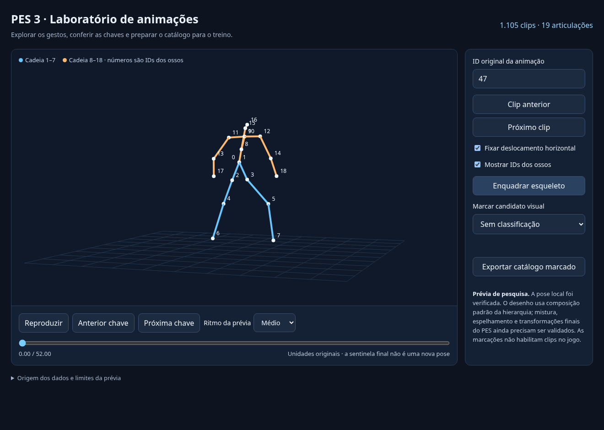

# Estudo do PES 3 para o centro de treinamento

Revisão de 10/10/2026. Base jogável aprovada pelo usuário:
`0cb7ead8dcf294755a0b0581f559cdeb241de0f3`.
Esta etapa acrescenta a conferência dos binários recebidos, um leitor validado
de animações e um laboratório offline para estudar os gestos. A integração
ao executável depende da adaptação do esqueleto e da validação dos contatos.

A etapa seguinte já acrescenta [recuperação automática do código](PES3-ACTIONS.md):
referências para 506 clips, filtros por ação/subestado e reescritas verificadas
de três roteamentos. O pacote atualizado é
[pes3-action-research.zip](../artifacts/pes3-action-research.zip); não exige
marcar os gestos manualmente para exportar as associações recuperadas.
Os corpos completos das ações e suas condições físicas continuam pendentes.

Com o save state de treino recebido, a etapa em
[PES3-SAVESTATE.md](PES3-SAVESTATE.md) acrescenta caminhos recompilados em
C++ e comparações de seleção/atualização usando a memória carregada. O
[laboratório atualizado](../artifacts/pes3-savestate-research.zip) consulta
os cenários e transições registrados. A integração ao jogo continua pendente.

A etapa [PES3-POSES.md](PES3-POSES.md) recupera caminhos de montagem, cache,
mistura, espelhamento e conversão, com comparações C++ e helpers semânticos
que dispensam a memória do PS2. O [laboratório de poses](../artifacts/pes3-pose-research.zip)
mostra campos compostos capturados ou reexecutados. As diferenças contra as
poses finais do emulador e a calibração para o jogador nativo permanecem abertas.

A continuação [PES3-RIG.md](PES3-RIG.md) entrega oito operações de rig em
estruturas próprias, origem conferida dos canais de rotação e investigação
da etapa correta de materialização. O [pacote numérico](../artifacts/pes3-rig-research.zip)
contém vetores e um verificador independente dos arquivos PES.

## Material recebido e alcance da conferência

Recebemos dois prints da ISO extraída e `analise-pes-sles51912.md`, com
172.981 bytes e SHA-256
`32f92a9d0bb9bea898f0e7a61677ff043f8e4d4969b228baf55365a5e9a6d7ea`.
O documento descreve outro projeto, um núcleo parcial v0.14. Na primeira
etapa tínhamos somente o texto e os prints; agora também recebemos
`fpsoccer-pes-nucleo-v14.zip`, `SLES_519.12`, `OVER.AFS`, `SYSTEM.CNF` e
`CDLIST.DIR`. O pacote inclui código, dados numéricos e referências de testes,
mas não a memória completa dos estados PCSX2 usados pelo estudo anterior.
Suas instruções de câmera, engine e cronograma pertencem àquele estudo;
o objetivo atual continua sendo nosso treinamento nativo em primeira pessoa.

| Informação | Origem | Situação nesta etapa |
| --- | --- | --- |
| `SLES_519.12`, `OVER.AFS`, `SYSTEM.CNF`, `CDLIST.DIR` | Arquivos enviados | ELF32 MIPS conferido; CNF indica PAL e executável SLES_519.12. |
| `DATA_F.AFS`, `DATA_G.AFS`, `DATA_S.AFS` | Prints | Presentes; não sabemos quais recursos cada arquivo desta cópia contém. |
| `SIZE_E.AFS` presente e `DATA_E.AFS` ausente da lista | Prints | Diferença a conferir com CNF, catálogo e executável; não prova corrupção. |
| 20 overlays, incluindo `game.ovl` | Leitura de `OVER.AFS` | Inventariados; três módulos reextraídos com hashes conferidos. |
| 1.105 blocos, 36.378 registros de pose, 19 articulações | Leitura do FPSANM14 recebido | Todos os índices, blocos, hashes, offsets e tempos conferidos contra o catálogo. |
| 1.439.665 verificações do núcleo parcial | Compilação e `make check` nesta nuvem | 16 baterias reexecutadas, zero divergências contra os vetores fornecidos. |
| 13.262 comparações de buffers no leitor JavaScript | Verificação desta etapa | Igualdade em bits nos 6.565 casos de decodificação/pose e 132 casos de canais capturados. |
| 0/132 poses finais inteiras idênticas | Comparação incluída no pacote recebido | Divergência aberta; não reexecutada contra estados completos nesta etapa. |
| 293 arquivos `.anim`, 195 contatos escritos, 14 canais por arquivo | Leitura deste checkout | Conferido pelo catálogo e pelos testes desta etapa. |

Os módulos IOP dos prints são componentes de execução do PS2, como áudio,
armazenamento, rede e controle. Seus nomes não localizam os clips dos atletas.
Os arquivos `.PSS` são candidatos a vídeo; não são a prioridade para animações.

## Conferência dos arquivos recebidos

O ZIP v0.14 recebido tem 20.702.174 bytes e SHA-256
`7561b99ddaca6e12c9c70f483a340c38dbb378172ae67911f2d092fe8f2bda5e`.
Conferimos os 167 arquivos listados em seu `SHA256SUMS` e extraímos os dados
para pesquisa sem alterar o anexo. `data/pes_animation_tracks.fpsa` tem
6.310.088 bytes e SHA-256
`c40813d6b23f77834877ba4a5863ae54f8b829f6fc8f2c606d373c618d26bbe5`.
Ele preserva os blocos numéricos atribuídos a `anime.bin`, `anime2.bin` e
`anime3.bin`. Os três arquivos brutos não foram enviados separadamente;
a igualdade deles com uma nova extração da ISO ainda não foi conferida.

`SLES_519.12` tem 2.196.728 bytes e SHA-256
`a3d39bf0f1d0030ccd4be17428d1dbdb7010e0b7a06ee545b5d614d378640b53`;
`OVER.AFS` tem 6.447.104 bytes e SHA-256
`aa1942fd00fd60c7bdbedea766e94bbe6b7865593a4ca1479c89681e464166f3`.
Ambos correspondem aos hashes do relatório. As 16 regiões de código/tabelas
de animação do manifesto v0.14 foram conferidas nos bytes do ELF recebido.
O hash de `game.ovl` reextraído e o da tabela de direções também correspondem
ao estudo. O [registro de validação](pes3-validation.json) conserva os
tamanhos, hashes, escopos e resultados desta etapa.

`CDLIST.DIR` relaciona DATA E/F/G/I/S e OVER. A diferença entre essa lista
e os prints não prova corrupção. Não precisamos de outro arquivo para usar
o laboratório atual. Para uma futura reextração independente, os recursos
relatados de **DATA E** são os seguintes; sua correspondência com F/G/S ainda
precisa ser verificada.

| Recurso relatado | Caminho relatado | Tamanho descompactado relatado |
| --- | --- | ---: |
| `0x00080000` / `anime.bin` | `020boot.afs/020boot_1.afs/020boot_1_pl.afs/020boot_1_pl_anime.afs` | 3.835.920 bytes |
| `0x00370000` / `anime2.bin` | `150pl.afs/150pl_anime.afs` | 1.302.320 bytes |
| `0x00370001` / `anime3.bin` | `150pl.afs/150pl_anime.afs` | 1.300.928 bytes |
| `0x00080001` / `game.mbc` | Mesmo contêiner de `anime.bin` | Payload relatado de 1.750 bytes; função desconhecida. |

## Abrir o laboratório no Windows 11

1. Baixe [pes3-animation-lab.zip](../artifacts/pes3-animation-lab.zip) e extraia.
2. Abra `abrir-laboratorio.html` com Edge ou Chrome. Não precisa instalar outro
   Windows, Python, Node ou copiar arquivos para a pasta do jogo.
3. Escolha o ID original, reproduza/pausa ou percorra as chaves. Arrastar gira
   a visão; a roda do mouse ajusta o zoom. “Enquadrar esqueleto” restaura a visão.
4. Opcionalmente marque candidatos visuais a corrida, passe, chute etc. Exporte
   o catálogo JSON antes de fechar a aba; as marcações ficam somente na sessão.



Os 1.105 clips e os dados necessários estão embutidos no HTML, que funciona
offline. O laboratório mostra articulações, sem a malha do atleta ou a bola.
O ritmo da prévia usa unidades originais por segundo; não comprova o FPS do
PES. A fixação horizontal modifica somente a visualização da raiz.

O JSON exportado conserva ID, hash do bloco e instante observado. A
classificação é um candidato visual: `retargeting_validated`,
`contact_validated` e `runtime_enabled` continuam falsos. O laboratório não
substitui o executável de treino nem importa automaticamente esses clips.

## Ferramentas implementadas

[`inspect.py`](../tools/pes3/inspect.py) lê arquivos sem executar código PS2.
Inventaria AFS aninhados, índices e offsets absolutos, nomes quando há um
diretório compatível e cabeçalhos de módulos. Lê os segmentos ELF32 MIPS
little-endian e permite converter um endereço virtual apenas quando ele
pertence a um único segmento com bytes presentes no arquivo. Regiões apenas
reservadas em memória não viram instruções fictícias.

Com extração solicitada, seleciona somente os recursos de animação/ligação,
`game.mbc`, `game.ovl`, `training_free.ovl` e `training_common.ovl`. Preserva
os bytes armazenados e, para o wrapper `0x00010600` descrito no relatório,
confere os 32 bytes de cabeçalho, tamanhos, checksum zlib, fim do fluxo e
ausência de payload excedente. A saída descompactada tem limite configurável.
Os nomes de saída usam índices e nomes sanitizados; arquivos existentes não
são sobrescritos. Layouts sem nomes continuam inventariados por índice,
mas não permitem encontrar animações só pelo nome. Outros wrappers e a
decodificação de formatos PS2 adicionais permanecem sem implementação.

Exemplos para quem tiver Python 3 no computador, dentro deste repositório:

```powershell
py -3 tools/pes3/inspect.py "C:\PES3_ESTUDO\01_ISO_EXTRAIDA\SLES_519.12" "C:\PES3_ESTUDO\01_ISO_EXTRAIDA\OVER.AFS" --output pes3-modulos.json --extract pes3-recursos
py -3 tools/pes3/inspect.py "C:\PES3_ESTUDO\01_ISO_EXTRAIDA\DATA_F.AFS" --output pes3-dados-f.json --extract pes3-recursos
```

No Linux, usar `python3` no lugar de `py -3`. Estes comandos são opcionais
para repetir a inspeção dos recursos na máquina local.
Para repetir uma extração, escolher uma pasta nova. Falhas retornam status
não zero e entram no relatório; extrações válidas de recursos anteriores
podem permanecer na pasta se uma entrada posterior falhar.

[`catalogue.py`](../tools/pes3/catalogue.py) cataloga a base aberta com hashes,
tipos de ação, propriedades, canais, chaves e eventos de bola escritos nos
arquivos. Valida quadros, números finitos, ordem das chaves e formato. O
endpoint de origem usa o passo **de 10 ms desta engine**, sem atribuir esse
tempo aos clips do PES.

```bash
python3 tools/pes3/catalogue.py --output /tmp/football-animation-catalogue.json
python3 -m unittest discover -s tests -p test_pes3_tools.py -v
```

São 24 testes com arquivos estruturais sintéticos e a base aberta real.
Cobrem AFS aninhados, limites/sobreposições, zlib inválido ou excessivo,
mapa ELF, extração sem alterar a entrada, nomes de saída, erros de catálogo
e limites do FPSANM14. A inspeção dos binários enviados e a comparação do
leitor com vetores reais são verificações separadas, registradas acima.

[`fpsa.py`](../tools/pes3/fpsa.py) valida os 1.105 blocos contra o catálogo.
[`motion.js`](../tools/pes3/motion.js) reproduz a decodificação local do
formato 2 e a interpolação do núcleo enviado. Preserva operações binary32,
tratamento de subnormais selecionado, ordem dos produtos, quaternions int16
e tempos irregulares; não normaliza quaternions nem reamostra as chaves.
[`verify_motion.js`](../tools/pes3/verify_motion.js) compara os buffers em bits
com os vetores recebidos. A sentinela de tempo zero não cria outra pose; o
clip 1022, por exemplo, possui última chave em 112 e duração declarada 114.

[`build_lab.py`](../tools/pes3/build_lab.py) empacota o leitor e o HTML offline,
incluindo manifesto de hashes. A composição das matrizes locais para desenho
usa cinemática direta padrão da hierarquia observada nos 132 registros.
Isso permite estudar os gestos, mas não reproduz as transformações finais,
caches, espelhamento ou mistura entre clips do PES.

Para repetir com o pacote v0.14 extraído em `PES_CORE`:

```bash
make -C "$PES_CORE" check
node tools/pes3/verify_motion.js "$PES_CORE/data/pes_animation_tracks.fpsa" "$PES_CORE/tests/animation_pose_vectors.json.gz" /tmp/pes3-motion-novo.json
python3 tools/pes3/build_lab.py --core "$PES_CORE" --output /tmp/pes3-laboratorio-novo.zip
python3 tests/pes3_lab_smoke.py /tmp/pes3-laboratorio-novo.zip --output /tmp/pes3-browser-novo.json
```

Escolha saídas novas: os geradores não sobrescrevem pacotes e relatórios.
O último comando requer Playwright Python e Chromium no ambiente de teste;
essas dependências não são necessárias para abrir o laboratório no Windows.
As 26 verificações do pacote e do navegador cobrem reprodução, pausa, tempos
originais, exportação, IDs, atalhos e tela estreita, com zero erros JavaScript
e zero requisições de rede. A política do Chromium da nuvem bloqueia `file://`;
por isso o teste carrega os mesmos bytes HTML com `set_content`. A abertura
por arquivo no Windows/Edge ainda exige conferência no computador do usuário.

## O que os resultados comprovam

`make check` recompilou o núcleo C++ com `-fno-fast-math` e
`-ffp-contract=off`, depois executou as 16 baterias. A referência é o conjunto
de vetores fornecido: não regeneramos a execução MIPS/VU contra estados
completos nem repetimos um quadro inteiro do jogo. As 1.439.665 verificações
não representam 1.439.665 animações ou validação da gameplay completa.

A comparação recebida de poses armazenadas tem zero poses inteiras idênticas
entre 132 observações e diferença máxima de componente 33,375921. Isso é
distinto dos testes de interpolação local que passaram. Caches, mistura,
espelhamento e escritas posteriores são hipóteses a investigar; ainda não
isolamos a causa. Não aplicamos compensação numérica para ocultar diferenças.

Os 509 recursos originais e o shader documentado do treino foram conferidos.
O pacote jogável Windows desta etapa conserva o hash
`ee913811b5fd1c5a18a3943a2228bb7b59436712b154b23826b7f8505d4b3443`.
Não foi necessária uma recompilação do jogo para o laboratório separado.

## Como o jogo já escolhe a animação

O ponto de integração é o C++ de
[`AnimCollection`](../src/onthepitch/player/humanoid/animcollection.cpp) e
[`Humanoid`](../src/onthepitch/player/humanoid/humanoid.cpp), preservando o
desempenho do treino. Python serve para preparar e conferir dados, não para
controlar o atleta a cada quadro.

`CrudeSelection` filtra ação, velocidade de entrada, direção do corpo,
direção da bola e estados especiais. `SelectAnim` mantém candidatos
compatíveis com o comando e ordena preferências. Nas ações com bola,
`GetBestCheatableAnimID` calcula o movimento e compara o gesto com a
trajetória prevista até achar um contato admissível. O treinamento já
reaproveita gestos de cabeceio de passe para finalizar pela altura da bola.

O catálogo de origem possui 283 arquivos carregados/espelhados e 10 templates;
o motor gera movimentos e contatos adicionais ao preparar a coleção. Por
isso 293 arquivos e 195 contatos escritos **não** são a contagem de clips
ou contatos disponíveis em runtime. O campo `touch_bodypart` é determinado
com a pose pelo motor, não inferido pelo nome do arquivo neste catálogo.

## Contrato do seletor ampliado

Cada clip importado deverá ter origem/hash, ID original, versão da conversão,
mapeamento de ossos, unidades/eixos comprovados, tempos das chaves, translação
da raiz, eventos de apoio/toque e limites de entrada/saída. Campos não
identificados ficam explícitos; não se inventa um evento a partir de um
registro auxiliar de oito bytes ou do nome `lnk`.

A seleção terá duas etapas:

1. **Admissibilidade física:** ação solicitada, fase/apoio da passada,
   posição e altura previstas da bola no contato, alcance da perna/cabeça,
   estados de posse e continuidade do toque em execução. Um candidato fora
   do alcance é rejeitado antes de qualquer pontuação.
2. **Preferência entre candidatos admissíveis:** continuidade da pose,
   diferença de velocidade/direção, tempo até o contato, custo da correção
   da raiz, pé de apoio e qualidade do pé dominante. Empates devem ser
   determinísticos; uma vantagem pequena não troca um clip a cada quadro.

A janela de contato compromete a ação até o toque ou um cancelamento
válido. Um cabeceio usa a cabeça; um passe de primeira não insere domínio;
um passe/chute libera a recuperação da condução; RB+RT mantém a recuperação
até um novo contato admissível. Essas condições já têm verificações no
treino e serão preservadas ao adicionar clips.

Não se substitui o teste físico por um ranking baseado apenas em distância.
Mistura visual e IK limitada refinam a pose; o impulso é publicado uma vez
no evento de contato, sem prender a bola ao jogador entre os toques.
Falha de importação ou falta de candidato conserva a coleção atual como
alternativa. Pesos e tolerâncias novas só serão definidos com clips
convertidos e trajetórias observadas, não pelo número de testes do relatório.

## Conversão e física: dependências concretas

O relatório descreve 19 articulações, mas os arquivos atuais têm 14 canais:
`player`, `body`, `middle`, `neck`, ombros/cotovelos e coxas/joelhos/tornozelos
de ambos os lados. O vetor de pais relatado não identifica sozinho os nomes
anatômicos, a pose de referência ou a orientação local de cada osso.
Antes de produzir um `.anim`, precisamos conferir as bases anatômicas,
orientações locais, unidades e contatos dos candidatos vistos no laboratório. Quaternions
compactados, tempos irregulares, mistura, espelhamento e translação da raiz
exigem tratamento separado; não basta renomear arquivos `.bin`.

Na física, o relatório distingue o atualizador real da previsão e registra
diferenças no arredondamento e no RNG. Também informa Y negativo para
elevação e divisores 256/213 cuja relação completa com o tempo não foi
estabelecida. Nosso motor usa Z positivo como altura, metros e passos de
10 ms. A escala visual de 256 unidades/m e os 60 Hz do outro treino são
escolhas daquele adaptador, não parâmetros do PES comprovados aqui.

Os testes locais do núcleo recebido foram reproduzidos; falta medir unidades,
trajetórias, quique, atrito, spin e contato. Previsão deve concordar com o
atualizador no horizonte relevante conforme seu escopo, sem ser tratada
como se fosse a atualização real. Força/elevação dependem também do instante
e do gesto de contato; não se ajusta gravidade para compensar um clip errado.

Os endereços do relatório — seleção de entrada `0x01853D30`, dispatcher de
23 handlers `0x0184F5C0`, gate `0x017BB0A0` e composição/mistura de poses —
localizam investigação, não APIs do nosso executável Windows. A referência
de módulos e hashes precisa acompanhar cada endereço.

## Critério para liberar a primeira integração

Usar uma coleção opcional e começar com poucos clips identificados:
parado, início/parada de caminhada/corrida, curva, condução e toque simples.
Conferir na visualização externa e em primeira pessoa: apoios dos pés,
ausência de esticamento, continuidade da raiz/câmera e instante de contato.
O primeiro conjunto ampliado deve passar também pelos exercícios de
cabeceio, primeira, inversão, carga de chute e condução RB+RT da base atual.

Para comparar com PES, registrar sequências consecutivas com entradas
conhecidas, configuração, RNG e ordem de atualização. Três savestates
isolados e referências executadas em um modelo restrito não comprovam
transições do quadro inteiro. As divergências de poses do relatório devem
ser diagnosticadas antes de chamar a integração de reprodução fiel.

## Fontes consultadas

- Relatório e pacote do usuário v0.14, identificados por tamanho/hash acima.
  Os caminhos de DATA E e a comparação com poses finais vêm dessa fonte;
  as conferências do ELF, OVER, dados numéricos e testes locais foram
  executadas nesta etapa e registradas em `pes3-validation.json`.
- Código do checkout aprovado de Gameplay Football, especialmente
  `animation.cpp`, `footballanimationextension.cpp`, `animcollection.cpp`
  e `humanoid.cpp`; catálogo regenerado com zero erros.
- [PCSX2: instruções R5900](https://github.com/PCSX2/pcsx2/blob/master/pcsx2/R5900OpcodeImpl.cpp),
  consultado em 10/10/2026: `MULT` e deslocamento aritmético `SRA` sustentam
  a necessidade de preservar bits/sinal no estudo. Snapshot de 41.783 bytes,
  SHA-256 `32f5ecad0f5bc4661ac37d1ca9b9ee5557954835c0d5474f4b53ff37a4b468cf`.
- [PCSX2: operações VU](https://github.com/PCSX2/pcsx2/blob/master/pcsx2/VUops.cpp),
  snapshot de 145.702 bytes, SHA-256
  `37d5098321e062956880637e90b6a975a8f28d88092a2f333f8f0d2e3750bd16`.
  Um cálculo binary32 do host não certifica todas as regras do PS2.
- [pyelftools: estruturas ELF](https://github.com/eliben/pyelftools/blob/main/elftools/elf/structs.py),
  snapshot de 25.460 bytes, SHA-256
  `1685f2e25692ea0c88f99df59d152318a27bbeebb93b0ceb54286f08651ba96a`.
  Conferida a organização dos cabeçalhos ELF32 e de seus segmentos; o leitor
  desta etapa foi escrito independentemente, sem dependências adicionais.
