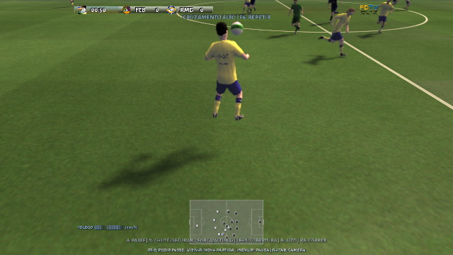
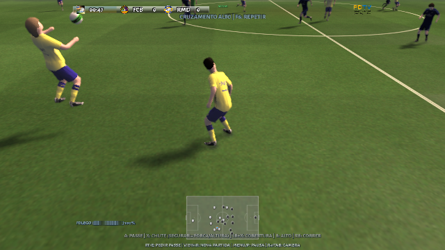

# Recepções ativas e divididas

Extraia o pacote Windows completo em uma pasta nova. Abra `treino-fisico.bat`
ou `partida-fisica.bat`. `run-training.bat` conserva o modo aprovado sem esta
camada física; use o atalho físico para observar esta revisão. R3/Tab alterna
a câmera externa e F7 permite comparar a física.

## O que mudou

A recepção deixa de depender apenas da reação a uma colisão ou da chegada da
bola ao chão. O seletor considera 194 adaptações completas de cinco movimentos
nativos, incluindo espelhamentos, alturas, tempos de preparação e saltos.
Os movimentos incluem alcance com chuteira/canela, amortecimento com coxa,
peito e cabeça, saltos e batidas com o pé no ar. Passes, chutes e cruzamentos
podem usar as preparações de batida elevada; as cabeçadas ofensivas conservam
os movimentos nativos específicos. O contato ainda precisa acontecer na pele
ponderada do modelo, com a mesma verificação geométrica final.

A CPU pode assumir uma recepção alcançável até acima da cabeça. A busca de
contato próximo de uma chegada aérea acontece a cada 10 ms também para a CPU
e para a condução automática. Assim, uma bola descendente não passa inteira
pelo intervalo entre duas decisões de animação. O controlador continua
permitindo recepções de uma bola que acabou de ser amortecida e ainda está no
ar; passes/chutes que o jogador acabou de dar não ativam essa assistência.

Sem entrada do analógico, a assistência humana espera o ponto previsto na
altura de recepção, em vez de correr até a projeção da bola ainda muito alta.
O jogador mantém os ajustes manuais. O domínio de cabeça recolhe o gesto após
amortecer; ele não continua o balanço de uma cabeçada forte contra a própria
bola.

Nas divididas, a pressão contínua anterior produzia no máximo 2,6 N·s por
passo, insuficiente para acionar uma passada protetora. Agora o contato real
entre os corpos também aplica impulsos opostos, calculados pela velocidade
de aproximação e massa reduzida, limitados a 240 N·s por episódio. O mesmo
controlador de equilíbrio recebe esse impacto nos dois jogadores. Frenagens
e mudanças de direção transferem mais peso para o tronco e a base, mantendo
o apoio das chuteiras por IK.

A caminhada lenta tambem pode frear ao soltar ou inverter o analogico, sem
esperar o fim do ciclo longo. A troca usa a transicao nativa a partir da
posicao atual; isso permite firmar o corpo e carregar a tracao de uma camisa.

## Testes no teclado

| Comando | Situação |
| --- | --- |
| F4 | Passe recebido rasteiro |
| F5 | Bola na região do peito |
| 7 + F5 | Chegada baixa na região da canela |
| 8 + F5 | Chegada na região da coxa |
| 9 + F5 | Bola descendente na parte superior |
| F6 | Cruzamento alto |
| Shift + F6 | Chegada mais alta para observar o salto |
| H + Shift + F6, na partida física | Mesmo teste para um companheiro CPU |
| H + F4/F5/F6, na partida física | Recepção por um companheiro CPU |
| Ctrl + F6, no treino físico | Altura aérea intermediária |
| Ctrl + F6, na partida física | Conserva o laboratório de goleiros |
| F2, na partida física | Aproxima um adversário para uma disputa |
| F8 / Shift + F8 / Ctrl + F8 | Impactos graduados para comparar o equilíbrio |

Esses atalhos organizam posições e trajetórias; não obrigam uma animação nem
concedem posse. A altura real no instante de contato pode ser diferente da
altura nominal do exercício: o jogador pode interceptar antes.

## Evidência e limites

O [relatório da revisão](approved-base-validation.json) identifica os binários
e os testes executados. Os testes novos exigem ação intencional no ar, contato
real, elevação da perna e dos dois pés no salto. As divididas verificam a
recuperação de apoio e o movimento do tronco desenhado para humano e CPU,
sem aplicar o impulso artificial de F8. Os arquivos originais continuam com
seus hashes preservados.

Capturas do teste renderizado, com câmera externa para inspecionar o corpo:

São adaptações procedurais, não 194 capturas novas. O motor muscular treinado
continua sendo o controlador angular pequeno documentado no projeto; esta
revisão não treina uma locomoção completa nem implementa a Euphoria. Uma bola
fora do alcance ou um impacto forte pode ser perdido. Os cenários testados não
provam domínio universal nem ausência de toda interpenetração. A execução
gráfica é verificada em Linux; o Windows é compilado e seu pacote portátil é
inspecionado, ficando a experiência no controle para o teste no PC do usuário.
